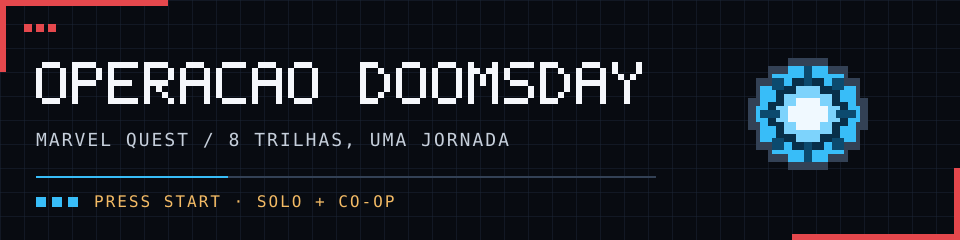

# Operação Doomsday

**Sua maratona Marvel, uma missão por vez.** Organize filmes e séries, acompanhe seu progresso e percorra oito trilhas narrativas rumo a *Avengers: Doomsday*.

`8 TRILHAS` · `12 PERSONAGENS` · `MODO SOLO + DUPLA` · `PROGRESSO LOCAL`

[Iniciar](#executar-localmente) · [Novidades](#novidades) · [Histórico de alterações](CHANGELOG.md) · [Contribuir](CONTRIBUTING.md) · [Reportar problema](https://github.com/imagalhaess/operacao-doomsday/issues/new/choose)

> **PRESS START** — Escolha uma produção, abra o dossiê ou use **Assistir agora** para acessar sua página oficial no Disney+. O aplicativo acompanha sua jornada; a reprodução acontece no serviço de streaming.

## Novidades

As alterações integradas à `master` em **20/11/2026** estão registradas no [histórico de alterações](CHANGELOG.md#2026-11-20).

| Área | O que mudou |
| --- | --- |
| Assistir agora | Links diretos oficiais em cards, trilhas e dossiês. São 77 entradas catalogadas, sem busca ou identificadores inventados. |
| Trilha 8-bit | Seleção dos 12 personagens, token na posição atual, nome flutuante e HUD de herói/nível/XP exclusivo dessa tela. |
| Identidade visual | Marca convencional nas demais telas; Reator Arc e favicon pixelados na trilha. Tipografia retrô sem Inter. |
| Som e cursor | Efeitos de hover, foco por teclado, clique e conquistas, com vinheta exclusiva ao subir de nível; cursor MCU convencional ou pixelado conforme a tela. |
| Estados | **Já assisti**, **Li o resumo**, **Vi uma parte** e **Pendente**. Selecionar o estado ativo volta para pendente. |
| Progresso | **Salvar progresso** baixa um arquivo; **Restaurar progresso** abre esse arquivo e substitui os dados atuais. |
| Confiabilidade | Pôsteres com fallback de iniciais/ano, atualização do cache e cabeçalho responsivo sem cortar os controles. |

## Escolha seu modo

| Tela | Para que serve |
| --- | --- |
| Dashboard | Consultar o panorama da maratona e o próximo título recomendado. |
| Minha maratona | Pesquisar, filtrar e registrar o estado de cada produção. |
| Trilhas (8-Bit) | Percorrer o mapa com seu personagem, consultar o HUD e acessar o modo em dupla. |
| Marvel Wrapped | Consultar a retrospectiva de progresso das trilhas. |
| Guia de conexões | Entender conceitos e conexões entre produções. |
| Meu histórico | Revisitar os títulos registrados. |

Os dossiês incluem resumos com **spoilers**, fatos importantes e conexões narrativas.

**Som:** clique em **Ativar som**, no cabeçalho de qualquer tela. Ao voltar ao aplicativo, o navegador pode exigir uma primeira interação para liberar a reprodução. O botão **Som ligado** desativa os efeitos. Não há música de fundo.

**Subida de nível:** a cada cinco produções marcadas como **Já assisti** (500 XP), você ganha um nível e recebe um aviso. Com o som ativado, toca uma vinheta 8-bit original de aproximadamente um segundo. Recarregar, navegar ou restaurar um backup não repete a comemoração; desfazer um título pode reduzir o nível, e alcançar o limiar novamente comemora a nova subida. Não usamos gravações ou trilhas sonoras dos filmes.

**Cursor:** no desktop, a luva repulsora identifica controles interativos. A versão pixelada aparece na trilha; as demais telas usam a versão convencional. Campos de texto e dispositivos de toque mantêm o comportamento nativo. O cursor do sistema operacional não é alterado.

## Executar localmente

Você precisa de **Git**, **Node.js 22.12 ou superior** — preferencialmente uma versão LTS — e **npm**. O Vite 8 não oferece suporte a Node 18.

```sh
git clone https://github.com/imagalhaess/operacao-doomsday.git
cd operacao-doomsday
npm ci
npm run dev
```

Abra **http://localhost:3000**. Mantenha esse terminal aberto enquanto usar o servidor.

| Comando | Resultado |
| --- | --- |
| `npm run dev` | Servidor de desenvolvimento com atualização durante a edição. |
| `npm test` | Testes de regressão com o runner nativo do Node.js. |
| `npm run build` | Verificação TypeScript e geração do site estático em `dist`. |
| `npm run preview` | Prévia do último build em **http://localhost:4173**. |

Para conferir a versão de produção localmente:

```sh
npm run build
npm run preview
```

> **Dev não é preview:** o preview não recompila suas edições. Gere outro build para vê-las nessa porta. Se ela estiver ocupada, confira a URL informada pelo Vite no terminal.

## Mapa do código

SPA em **TypeScript 7**, **Vite 8**, **Tailwind CSS 4**, **daisyUI 5** e **PeerJS**, sem framework de componentes.

```text
operacao-doomsday
├── .github           Modelos de issue e pull request
├── docs
│   └── assets        Identidade visual da documentação
├── public            Ícones, cursores, manifesto PWA e Service Worker
├── src
│   ├── components    Renderização das telas, cards, dossiês e controles
│   ├── data          Trilhas, personagens, resumos e links catalogados
│   ├── easter-eggs   Efeitos visuais e marcos de progresso
│   ├── state         Persistência, estatísticas, estado de UI e coop
│   ├── styles        Estilos convencionais, pixel art e responsividade
│   ├── utils         Síntese de áudio e cursor temático
│   ├── app.ts        Renderização principal e eventos delegados
│   ├── router.ts     Navegação por hash
│   └── utils.ts      Escape de HTML, datas e rótulos compartilhados
├── tests             Regressões de personagens, links, áudio, cache e UI
├── CHANGELOG.md      Histórico das entregas
└── CONTRIBUTING.md   Preparação do ambiente e fluxo de contribuição
```

O fluxo principal é **evento → atualização de estado → renderização**. Os componentes retornam HTML; o progresso é persistido pelo módulo `src/state/store.ts`. Os atalhos do Disney+ usam um único componente, `src/components/watch-now.ts`, e um mapa por ID em `src/data/links.ts`.

## Contribuir

Abra uma [issue](https://github.com/imagalhaess/operacao-doomsday/issues/new/choose) para discutir mudanças maiores e siga o [guia de contribuição](CONTRIBUTING.md). Não é necessário começar com uma funcionalidade: correções de texto, acessibilidade e curadoria com fontes oficiais também ajudam.

Boas primeiras contribuições:

- Conferir um link do Disney+ e registrar a fonte e a região consultada.
- Reproduzir um problema e incluir passos claros, navegador e captura sem dados pessoais.
- Melhorar navegação por teclado, contraste ou leitura em telas pequenas.
- Corrigir documentação ou acrescentar uma regressão para um bug.

Os modelos de issue e PR ajudam a descrever contexto, resultado esperado e verificações. Mudanças relevantes devem atualizar o [changelog](CHANGELOG.md), sem transformar cada ajuste de formatação em uma entrada.

## Dados e limites

**Progresso local, não uma conta na nuvem.** Os registros ficam no `localStorage` do navegador, sem criptografia implementada pela aplicação. Limpar os dados do site, usar outro navegador ou trocar de origem/porta não transfere o progresso. Guarde um arquivo com **Salvar progresso** antes de trocar de aparelho ou limpar dados. O JSON exportado pode conter notas pessoais; não o publique em issues.

**Offline parcial.** Após o primeiro carregamento online, o Service Worker pode reutilizar páginas e assets locais já cacheados. Disney+, pôsteres externos, fontes ainda não carregadas e conexões em dupla precisam de rede. Não há garantia de funcionamento integral offline.

**Disney+ é um serviço externo.** Os links abrem em nova aba e podem exigir login, assinatura e disponibilidade regional. Séries abrem a página da produção, onde se escolhe a temporada. Não há login integrado nem reprodução automática. Títulos sem URL verificada mostram um aviso; Doomsday ainda não oferece reprodução do filme completo no catálogo atual da aplicação.

**Modo em dupla.** Usa PeerJS/WebRTC e depende de sinalização e conectividade de rede. Compartilhe o código da sala apenas com quem deve receber seu progresso; o payload de sincronização inclui seus registros de progresso, que podem conter notas.

**Coop no preview.** A CSP atual do preview permite conexões apenas à própria origem (`connect-src 'self'`), bloqueando a sinalização externa. Para desenvolver esse fluxo, use `npm run dev`. Na hospedagem, as origens necessárias ao PeerJS precisam ser autorizadas explicitamente.

**Segurança de publicação.** Os cabeçalhos configurados no Vite para desenvolvimento/preview não são automaticamente instalados no servidor de hospedagem. Ao publicar `dist`, configure HTTPS, CSP e demais cabeçalhos no provedor. Preserve o escape de HTML para conteúdo dinâmico e não coloque credenciais no frontend.

### Problemas comuns

| Sintoma | O que conferir |
| --- | --- |
| Preview não abre | O processo `npm run preview` precisa estar em execução; use a porta indicada no terminal. |
| Alteração não aparece | No preview, gere um novo build e recarregue a página. O servidor de desenvolvimento é mais adequado para editar. |
| Som não toca | Use **Ativar som**, interaja com a página e confira o volume e o mute da aba/aplicativo. |
| Pôster não carrega | Pode haver indisponibilidade da URL ou da rede. O card mantém as iniciais e o ano como fallback. |
| Herói/nível não aparecem | O HUD é exclusivo da rota **Trilhas (8-Bit)**. |
| Progresso parece ter sumido | Confira se está no mesmo navegador e origem/porta; restaure um arquivo salvo anteriormente, se necessário. |

## Créditos e licença

- Projeto independente de fãs, sem afiliação oficial com Marvel ou Disney. Marcas, personagens e materiais de terceiros pertencem aos respectivos titulares.
- Tipografia: Press Start 2P, Silkscreen e DM Mono, carregadas pelo Google Fonts.
- Pôsteres referenciados no TMDB; disponibilidade das imagens depende desse serviço.
- Ícones e cursores locais em SVG. A pesquisa visual incluiu [Pixelarticons](https://pixelarticons.com/docs/), [NES.css](https://nostalgic-css.github.io/NES.css/) e um [cursor 8-bit do Homem de Ferro](https://www.rw-designer.com/cursor-detail/130701); essas bibliotecas e esse arquivo `.ani` não foram incorporados como dependências.
- Links Disney+ conferidos em 20/11/2026 no [catálogo Marvel](https://www.disneyplus.com/brand/marvel), no [guia oficial de ordem dos filmes](https://www.disneyplus.com/explore/articles/marvel-movies-in-order) e nas páginas das produções.

**Licença do código:** o código autoral é distribuído sob a [licença MIT](LICENSE), que permite uso, modificação e distribuição, inclusive comercial, desde que os avisos de autoria e licença sejam preservados. Materiais de terceiros, incluindo marcas, personagens, pôsteres, fontes e dependências, não são relicenciados por este projeto e continuam sujeitos aos direitos e às licenças de seus respectivos titulares.
